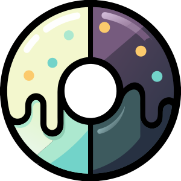

<p align="center">
  
</p>

<h1 align="center">Glaze</h1>

<p align="center">
  <a href="https://github.com/tenphi/okhst">OKHST</a>-based color theme generator with WCAG and APCA contrast solving
</p>

<p align="center">
  <a href="https://www.npmjs.com/package/@tenphi/glaze"></a>
  <a href="https://github.com/tenphi/glaze/actions/workflows/ci.yml"></a>
  <a href="https://github.com/tenphi/glaze/blob/main/LICENSE"></a>
</p>

---

Glaze generates **light**, **dark**, and **high-contrast** color schemes from a
single hue/saturation seed. Relationships stay explicit: colors either define
an absolute tone or depend on a named base through a tone delta and an optional
contrast floor.

## Features

- **OKHST color space** — OKHSL with a contrast-shaped **tone** axis. Equal
  steps give equal WCAG contrast for neutrals and a useful approximation for
  chromatic colors. See [Tone and OKHST](docs/okhst.mdx) and the
  [full OKHST specification](https://github.com/tenphi/okhst).
- **WCAG 2 + APCA contrast solving** — automatic tone adjustment to meet a WCAG ratio or APCA Lc floor
- **Unified dark mode** — one tone space for light, dark, and high-contrast; dark is a single `100 − t` inversion, no fitted curve
- **Mix colors** — blend two colors with OKHSL or sRGB interpolation, opaque or transparent, with optional contrast solving
- **Shadows and glows** — translucent overlays whose opacity is solved per surface, so `intensity` is an exact tone step wherever the surface has room for it (a step past black or white is pinned and warns), with object-aware strength
- **HDR glows** — set `glowTuning.headroom` and a glow whose step passes white also gets an exact HDR value: extended sRGB `color(srgb …)` with channels past 1, plus a base and an exposure in DTCG for native apps, exported when you turn on `modes.hdr`. See [HDR glows](docs/hdr.mdx).
- **Light + Dark + High-Contrast** — all schemes from one definition
- **Manual contrast level** — put your normal palette on a `0–100` slider between itself and the high-contrast one; every level in between is solved, not approximated, and the high-contrast tier stays available on top
- **Per-color hue override** — absolute or relative hue shifts within a theme
- **Multi-format output** — native `rgb`, `hsl`, and `oklch`, plus
  [Tasty](https://tasty.style)-compatible `okhsl` and `okhst`
- **CSS custom properties export** — ready-to-use `--var: value;` declarations per scheme
- **W3C DTCG export** — spec-conformant `.tokens.json` (2025.10) for Figma, Tokens Studio, Style Dictionary, and every DTCG tool
- **W3C DTCG Resolver-Module export** — opt-in single-document `dtcgResolver()` (sets + a `scheme` modifier with a context per variant) for resolver tools such as Dispersa
- **Tailwind CSS v4 export** — `@theme` block + dark / high-contrast overrides
- **Import/Export** — serialize and restore themes, color tokens, and entire palettes as JSON
- **Create from hex/RGB** — start from an existing brand color
- **Zero dependencies** — pure math, runs anywhere (Node.js, browser, edge)
- **ESM + CJS** — dual-format package
- **TypeScript-first** — full type definitions included

## Installation

```bash
pnpm add @tenphi/glaze
```

```bash
npm install @tenphi/glaze
```

```bash
yarn add @tenphi/glaze
```

## Quick Start

```ts
import { glaze } from '@tenphi/glaze';

glaze.configure({
  modes: { dark: true, highContrast: true },
});

const theme = glaze(280, 80);

theme.colors({
  surface: { tone: 97, saturation: 0.15 },
  'surface-text': {
    base: 'surface',
    tone: '-1',
    saturation: 0.4,
    contrast: { apca: ['content', 'body'] },
  },
  border: {
    base: 'surface',
    tone: ['-8', '-16'],
    saturation: 0.2,
    inherit: false,
  },
  'accent-surface-text': { tone: 100, mode: 'fixed' },
  'accent-surface': {
    base: 'accent-surface-text',
    tone: '-1',
    contrast: 'AA',
    mode: 'fixed',
  },
});

const danger = theme.extend({ hue: 23 });
const palette = glaze.palette({ default: theme, danger });

const tokens = palette.tokens({
  prefix: { default: '', danger: 'danger-' },
});
// → {
//   light: { surface: 'oklch(...)', 'danger-surface': 'oklch(...)', ... },
//   dark: { ... },
//   lightContrast: { ... },
//   darkContrast: { ... },
// }
```

The accent fill is solved against its white label, not the reverse: the fill
darkens until the pair meets `'AA'`, or `'AAA'` in high contrast, where a bare
`'AA'` rises a tier.

## Concepts at a glance

1. **A theme has one hue/saturation seed.** Create status themes with
   `extend()` so they inherit the same relationships while changing hue.
2. **A color is a root or a dependent.** Roots use an absolute `tone` or
   `'max'`/`'min'`. Dependent colors name a `base` and may use a signed
   **tone delta** such as `'-8'` plus a `contrast` floor.
3. **Tone is an authoring axis, not a contrast guarantee.** Equal tone deltas
   are exact WCAG steps for neutrals. Chromatic colors can drift in rendered
   luminance, so Glaze measures contrast floors against the resolved colors.
4. **`contrast` is a floor.** A bare number or preset means WCAG;
   `{ wcag }` and `{ apca }` select the metric explicitly. The solver keeps
   the requested tone whenever it already clears the floor with a small
   margin (1% over a WCAG ratio, 0.5 Lc over an APCA target).
5. **Each color chooses its dark adaptation.** `mode: 'auto'` uses dark tone
   inversion (`100 - t`), `fixed` keeps the authored side of the tone scale,
   and `static` skips scheme adaptation.
6. **Tone windows bound ordinary schemes.** `lightTone` and `darkTone`
   configure the light and dark tone windows. High-contrast variants use the
   full range. Values that accept `[normal, highContrast]` pairs can tighten
   deliberately in HC.

In Glaze, a **scheme variant** is one of `light`, `dark`, `lightContrast`, or
`darkContrast`. Export `modes` choose which variants are included; [Tasty](https://tasty.style)
`states` choose how those variants are activated in an application.

## Choosing an output

- `tasty()` returns [Tasty](https://tasty.style) `#token` bindings, including its custom `okhsl()` or
  `okhst()` serialization.
- `tokens()` and `json()` return JavaScript data and default to native
  `oklch()` values.
- `css()` returns custom-property declarations.
- `dtcg()` / `dtcgResolver()` target design-token tooling.
- `tailwind()` emits a Tailwind CSS v4 theme.

## Documentation

The full documentation, with live examples that follow your light / dark and
contrast preferences, is at [glaze.tenphi.me](https://glaze.tenphi.me). The
same pages live in [`docs/`](docs):

- [Getting started](docs/getting-started.mdx) — install, build a first theme,
  and export it.
- Concepts: [light, dark, and high contrast](docs/schemes.mdx),
  [contrast solving](docs/contrast.mdx),
  [shadows and glows](docs/shadows-and-glows.mdx),
  [mixes and transparency](docs/mixes.mdx), and the color model under them,
  [tone and OKHST](docs/okhst.mdx).
- Guides: [designing a palette](docs/methodology.mdx),
  [exporting and integration](docs/exporting.mdx), and
  [migration and upgrading](docs/migration.md) (including Glaze 2 → 3).
- The [API reference](docs/reference/index.md) for every method, option, and
  type.
- Explore the tone axis in the
  [ramp explorer](https://glaze.tenphi.me/okhst/#ramp-explorer), or read the
  [full OKHST specification](https://github.com/tenphi/okhst) for its math.
- [`AGENTS.md`](https://github.com/tenphi/glaze/blob/main/AGENTS.md) — source-tree orientation for contributors.

## License

[MIT](https://github.com/tenphi/glaze/blob/main/LICENSE)
